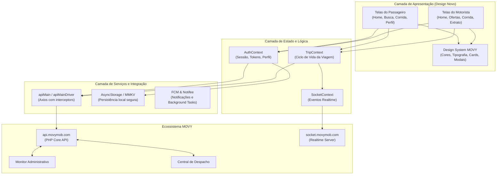

# ARQUITETURA TÉCNICA — MOVY MOBILE (`mobility-pro-app-rota101-pro`)

> **Documento Oficial de Engenharia — Reconstrução MOVY**  
> **Base Tecnológica Preservada:** React Native 0.81.5 + Expo SDK 54 + React 19.1.0 + TypeScript 5.9.2

---

## 1. Princípios Arquiteturais

A reconstrução do aplicativo MOVY foi projetada para resolver a fragmentação histórica de código, mantendo rigorosa compatibilidade com as APIs em produção (`https://api.movymob.com/` e `socket.movymob.com`) e eliminando código duplicado.

### Pilares:
1. **Preservação Tecnológica:** Utilização exclusiva do ecossistema React Native / Expo já existente, sem migração para Flutter ou linguagens não autorizadas.
2. **Separação de Camadas (Clean UI & Domain):**
   - **Apresentação (Presentation):** Telas, componentes reutilizáveis, design system padronizado e feedback visual rico.
   - **Gerenciamento de Estado (State):** Contextos desacoplados por responsabilidade (`AuthContext`, `TripContext`, `SocketContext`, `ThemeContext`).
   - **Casos de Uso e Domínio (Services & Repositories):** Comunicação estruturada com as APIs de mobilidade, delivery e serviços nativos.
   - **Infraestrutura Nativa (Native Drivers):** Integração com câmera, localização em segundo plano, canais de notificação Android e Bubble Service.
3. **Resiliência e Idempotência:**
   - Tratamento de timeout em conexões lentas (45s em uploads de documentos, 15s em chamadas normais).
   - Reconciliação automática de estado com o servidor ao reconectar da rede.
   - Bloqueio de submissão duplicada em formulários e despachos.

---

## 2. Diagrama de Fluxo e Camadas

---

## 3. Gestão de Rotas e Navegação

O aplicativo utiliza um roteador centralizado em `src/routes/index.tsx` que avalia:
1. **Estado de Autenticação:**
   - Usuário deslogado → `GuestRoutes` / `AuthRoutes` (Apresentação, Login, Cadastro unificado).
2. **Perfil do Usuário Autenticado:**
   - `userType == 'customer'` → Carrega pilha do passageiro (`src/client/routes/app.routes.tsx` e `tab.routes.tsx`).
   - `userType == 'driver'` → Carrega pilha do motorista (`src/driver/src/routes/app.routes.tsx`).
3. **Pendências Cadastrais do Motorista:**
   - Status pendente (`StatusPending`) ou documentos rejeitados (`DocumentPending`) desviam o motorista para a tela de regularização antes de permitir que fique online.

---

## 4. Comunicação Realtime e Ciclo de Vida da Viagem

O ciclo de vida da corrida é coordenado via Socket.IO e reconciliado via REST API:

| Etapa | Ação no App | Evento Socket / Rota API | Fonte Autorizada |
|---|---|---|---|
| **1. Estimativa** | Passageiro seleciona categoria | `POST Trip/Estimate` | Servidor calcula preço com regras da cidade |
| **2. Chamada** | Passageiro solicita viagem | `POST Trip/Request` | Corrida gravada no banco; dispara despacho |
| **3. Oferta** | Motorista recebe notificação | Push `RIDE_OFFER` + Socket `trip-offer` | Contagem regressiva no card de oferta |
| **4. Aceite** | Motorista aceita | `POST Trip/Accept` | Servidor valida se a corrida ainda está livre (evita duplo aceite) |
| **5. Chegada** | Motorista chega ao local | `POST Trip/Arrived` + Socket `driver-arrived` | Passageiro notificado por push e aviso sonoro |
| **6. Início** | Motorista inicia corrida | `POST Trip/Start` + Socket `trip-start` | Inicia taxímetro / acompanhamento de trajeto |
| **7. Finalização** | Motorista conclui trajeto | `POST Trip/Finish` + `trip/payWithPixAtEnd` | Servidor calcula valor final e aplica comissões |
| **8. Cancelamento** | Passageiro, Motorista ou Central cancela | `POST Customer/CancelTrip` + Socket `trip-canceled` | Libera motorista imediatamente e reestabelece disponibilidade |
