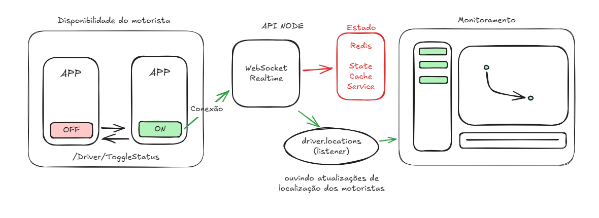

## API node

# SocketIO conexão

Já havia um projeto inicial com socketio no chamado, essa documentação é a parte v2. Inicialmente vamos começar pelo
monitoramento dos motoristas.

Tudo se inicial pela função ```handleConnection(client: Socket)``` em  ```event.gateway.ts``` que será responsável pela conexão socket.io do motorista com o servidor. Nela será passado as informações do client para ```eventEmitterService.ts``` na função ```connectClient``` que irá verificar se existe um driverId (deve ser passado na query params da url de conexão com o websocket), se existir será feito os processos adiante para buscar os dados do motoristas e adicionar sua conexão no redis.

O use case ``realTimeDriverConnectionUseCase`` ficará responsável por fazer esse papel de pegar os dados do motorista no banco de dado e salvar no REDIS assim como sua localização no momento da conexão. (Esses dados são cacheados, e a localização vem direto do webhook, não mais do banco de dados). A classe `StateCacheService` é responsável por ter os metódos para auxiliar a manipulação do estado dos motoristas conectados.

> ATENÇÃO: As rotas não estão autenticadas

A conexão é feita usando o `driverId` como parâmetro se for passado um id de um motorista que não existe irá disparar um erro no console.

#### Hierarquia de Chamada de classe  
/event.gateway.ts  
--/eventListenerService.ts|eventEmitterService.ts  
----/driver.service.ts  
------/*driverUseCase.ts



#### Banco de motoristas online

Usamos o redis como banco e fila de controle dos motoristas online, baseado na key `connected_driver.` ou const `DRIVER_LOCATION`, acrecido no final da key o driverId, exemplo: `connected_driver.666`

Sempre que um motorista se conectar ao servidor socket.io, ele terá esse registro no redis, onde poderá ser recuperado usando a função `getOnlineDrivers` da classe `driver.service.ts`. Quando a conexão com o servidor socket.io é encerrada o motorista é removido da lista.

#### Inserção de localização

Hoje é feito no banco diretamente a localização do motorista, isso deve mudar futuramente.

### Melhorias a fazer

Aumentar o cache do dados do motorista assim que deixar a informação do status do motorista dinâmica.

## Driver Module - SockerIO
> como o motorista deve se conectar ao socket.io
@Ws(/?driverId=1&latitude=-10&longitude=-10)
```json
{}
```

### Client event
> evento que o app motorista deve enviar para atualizar as informações de localização
@Ws(/?driverId=1&latitude=-10&longitude=-10)
```json
{
    "latitude": "-10",
    "longitude": "-10"
}
```

> ATENÇÃO
Sempre que há eventos de algum motorista, é emitido um evento driver `driver.positions` para 

## Driver Module - HTTP

### Lista todos os motoristas online
@Get(/driver/online)  
>payload
```json
{
    "status": true,
    "message": "Listando viagem",
    "data": [
        {
            "idDriver": 153,
            "userId": 384,
            "status": "desligado",
            "lastLat": "-3.7075835",
            "lastLon": "-38.5609677",
            "profileImage": "384d99dc49d-5b97-e404-51.png",
            "userName": "Jefferson Teste",
            "userPhone": "(85) 99277-6565",
            "userNickname": "Jefferson",
            "driverRegisterStatusId": 1,
            "userTypeId": 7,
            "userRating": 5,
            "userType": "MOTORISTA PARTICULAR",
            "driverRegisterStatus": "ATIVO"
        }
    ]
}
```


