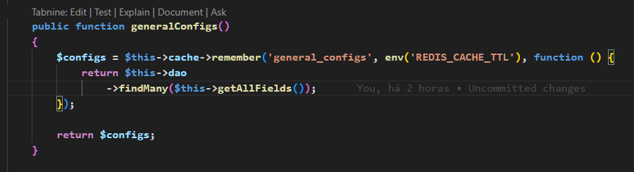

# Mobilidade API PHP is the API project for the mobility applications of 704apps.

## 🔥 Introduction

The PHP Mobility API enables communication between mobile urban mobility applications and the 704apps servers, thus ensuring the proper functioning of the systems.

### ⚙️ Prerequisites
You must have Docker and Docker composer installed on your machine and configuration AWS.
- https://github.com/704apps/documentation/blob/main/guides/aws-configuration.md

### 🔨 Installation Guide
Step 1:
- First, clone the project to test on your machine using:
```git clone + link```

Step 2:
- Start Docker Desktop on your machine.

Step 3:
- Now we will launch the container with Docker:
```docker compose up -d```

Step 4:
- Now we will list the containers, display the port where the project will run, and show its ID (save the ID of the Mobility API PHP container).
```docker ps```

Step 5:
- To enter the Container, we will run the following command:
```docker exec -it (container ID) bash```

Step 6:
 - Now we need to install the project dependencies:
```composer install```

Step 7:
- If everything went well, your project should be running correctly at the following port:
```localhost:8101/(endpoint here)```

## 📦 Technologies Used:
* 


# Docs

## Cache

A aplicação tem alguns pontos que podem ser otimizados usando cache, evitando o uso exagerado de recursos e otimizando o tempo de resposta.

A aplicação consiste em vários tipos de cache:

### Redis

Responsável pelo cache de querys SQL evitando usado exagerado do banco de dados e aumentado
a velocidade de resposta dos endpoints.

A classe responsável pelo controle do cache é `App\Utils\CacheUtils`, possui todos os métodos para 
manipulação de cache REDIS.

O seu uso principal e o `get` e o `set`, mas é recomendado o uso do `remember` onde recebe como paramentros
o valor da chave de cache, os segundos que esse cache deve ficar armazenado e a função de callback que deve ser
executado se o cache já foi expirado.

O construtor da classe recebe um paramentro que indica se deve considerar a chave para cada tenancy ou se é de uso geral.

O recomendado é que o paramentro sempre seja `true`, a não se que seja alguma feature muito especifica que impacte todos os cliente
de uma só vez.

Ex uso:

```php
$cache = new CacheUtils(true);

$configs = $cache->remember('config', 60, function() {
    return $allConfigs;
})
```

O uso de cache de querys é limitado conforme a dinâmica da aplicação, recomendado que sempre tenha uma gatilho de limpeza, uma
ação que provoque a mudança dos dados, ou o envio de dados dinâmicos.

Exemplo de modificações feita no código implementando cache Redis



Para a classe de cache busque do cache do Redis é necessário que a variavel de ambiente CACHE_ENABLED esteja como ```true```

